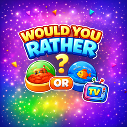
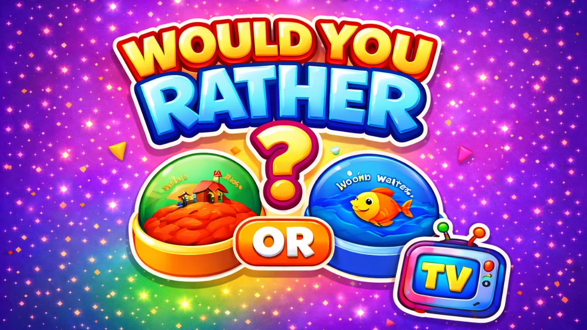
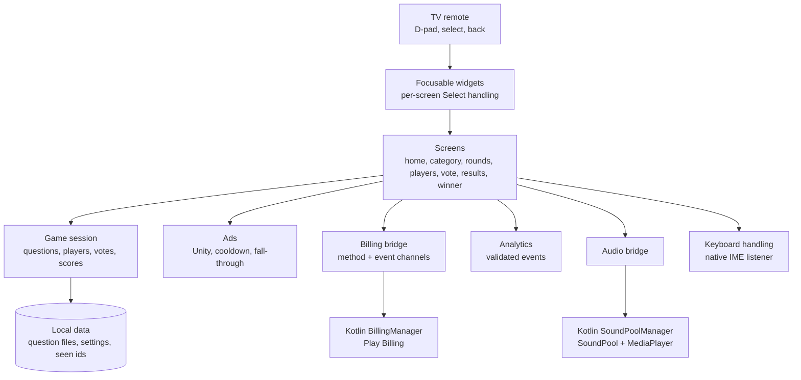

# Would You Rather TV

**A pass-the-remote party game for Android TV: everyone in the room votes on the same two-option question, and the players who land on the majority side score the point.**

 <b>Product artwork</b>: the TV launcher banner (design asset, not a screenshot).

**Android TV** 
Flutter · Dart · Kotlin · Riverpod · Firebase Analytics · Play Billing · Unity Ads · D-pad focus architecture

---

## Get the App

  

The Play listing is titled "Would You Rather TV Party Game". The app declares the Leanback requirement, so it is offered on Android TV devices.

## Product at a Glance

| | |
|---|---|
| **What it is** | A living-room party game: a question with two options appears on the TV, each player votes in turn with the remote, and the majority side scores |
| **Platform** | Android TV only (Leanback required, TV launcher banner, no touchscreen requirement, sensor landscape) |
| **Input** | Remote D-pad, Select and Back. On-screen keyboard for player names |
| **Players** | 2 to 6, each with an optional custom name |
| **Rounds** | 3, 5, 7, 10 or 15 questions per game; a per-vote timer of 20 to 120 seconds in 20-second steps (default 60) |
| **Content** | 13 categories, 4 free and 9 paid. 14 bundled question files at 200 entries each; 13 are loaded, 2,600 entries, about 2,500 distinct after the app drops repeated pairs. Counted by entry, not by reading the content |
| **Voting** | Local only. The votes are the players' own, taken one after another on the same TV. No global or online statistics exist in the app |
| **Monetisation** | Unity Ads (banner, interstitial, rewarded), a one-time remove-ads purchase, nine one-time category purchases through a native Play Billing manager |
| **Telemetry** | Firebase Analytics behind a validating layer; player names are never sent |
| **Code size** | About 9,000 lines of hand-written Dart (47 files, plus about 1,300 generated lines) and about 530 lines of Kotlin |
| **Tests** | 38 test cases in 5 files (analytics validation, session and input tracking, screen tracking, plus one smoke test) |

## Product Artwork

**No real Android TV screenshots are included in this repository.** Both images below are production artwork. Neither is a screenshot, and neither shows the app running on a device.

<table>
  <tr>
    <td align="center"> <b>TV launcher banner</b> Product artwork (not a screenshot)</td>
    <td align="center"> <b>App icon</b> Product artwork (not a screenshot)</td>
  </tr>
</table>

The app draws its in-game screens in code, so there are no other image assets to show. See [docs/PRIVACY_AND_SOURCE.md](docs/PRIVACY_AND_SOURCE.md).

## One Game. One Remote.

  

## Key Features

- **Pass-the-remote voting.** Every player votes on the same question in turn. Players who match the majority get a point; a tie awards none.
- **Thirteen categories.** Four free categories and nine paid ones, from food and superpowers to survival and a mixed party category.
- **Fresh questions.** Each category is shuffled with a secure random source, and questions already shown in earlier finished games are filtered out until the pool is used up.
- **Time pressure.** A per-vote countdown with a colour change and a tick sound in the last five seconds. When it runs out, a random choice is made for that player.
- **Pause and scoreboard.** A pause menu and a mid-game scoreboard are one button away, both reachable with the D-pad.
- **Custom names on a TV.** Names are typed with the TV's own keyboard, with extra handling for the keyboard closing.
- **Ways to unlock.** A one-time purchase per category, or a rewarded ad that opens a category until the app is closed.
- **Audio.** Seven sound effects and five selectable music tracks, stopped when the app leaves the foreground and restarted on return.
- **Offline play.** Questions and scoring need no connection. Ads, purchases and analytics do.

## Engineering Highlights

### Playing a social game with a remote
- **Problem:** a TV remote has four arrows and one confirm key, and a party game puts several people in front of one device. Every control must be reachable and obvious, and Select must always do what the highlighted control says.
- **Approach:** each interactive widget is its own focus target. It animates scale, border and glow on focus, handles Select and Enter itself, and the framework's directional traversal moves between them. A global hardware-key hook plays a navigation click without consuming the key. Scrolling screens call `ensureVisible` when a card gains focus.
- **Outcome:** every screen is operated with arrows and Select, the first sensible control takes autofocus, and focus feedback is a visible state change rather than a system default.

### Typing names with a TV keyboard
- **Problem:** on Android TV the keyboard is a separate activity. When the user closes it with Back, Flutter often receives no focus change, so a text field can keep a blinking cursor while the remote does nothing.
- **Approach:** three independent signals are combined: a native window-insets listener that calls Dart over a method channel when the keyboard hides, a view-inset change in Dart, and the app resuming. Any of them drops the text connection, restores a default name if the field is empty, and hands focus back to the row.
- **Outcome:** closing the keyboard from any direction returns the user to a focused row.

### Dialogs and overlays that hold focus
- **Problem:** a dialog, a pause overlay or a full-screen ad takes focus, and a TV user cannot tap to get it back.
- **Approach:** dialogs and the pause overlay sit in their own focus scope with autofocus on the safe default (Resume, Buy, or the single OK button), and the unlock dialog routes Back through a pop handler. The vote screen sets a flag while another screen is on top so its timer does not run underneath.
- **Outcome:** focus lands on a predictable control after each hand-off, and the timer only runs while the question is visible. A mixin with a 300 ms Back guard against key repeat exists in the code but is not wired into any dialog, so that protection is not active.

### A round built on local, honest voting
- **Problem:** "Would you rather" games are usually remembered for the percentages that appear afterwards, which would mean a backend.
- **Approach:** the app does not pretend. Votes are collected from the players in the room, counted locally and shown as vote counts, with a majority rule and a tie rule. No network call carries a vote to a shared service.
- **Outcome:** what the results screen shows is exactly what the people in the room chose.

### Not letting an ad block the game
- **Problem:** an interstitial that never calls back would leave a TV on a spinner.
- **Approach:** interstitials are skipped when the SDK is not ready or a cooldown is active, and every failure and skip path calls the continuation. Rewarded ads are the opposite by design: a reward is granted only on completion. Banner and interstitial paths check the remove-ads setting first.
- **Outcome:** an ad that fails or is skipped falls through to the next screen, and a failed rewarded ad never unlocks a category.

### Native billing behind two platform channels
- **Problem:** Play Billing is asynchronous and callback based, with pending purchases and acknowledgement.
- **Approach:** a Kotlin manager owns the billing client, queries products and purchases, and acknowledges purchases. Dart reaches it through one method channel and one event channel, and the screens listen to a broadcast stream of purchase events.
- **Outcome:** screens react to plain events (purchased, cancelled, error) without touching the billing client.

More: [docs/ENGINEERING_CHALLENGES.md](docs/ENGINEERING_CHALLENGES.md).

## Architecture

Details: [docs/ARCHITECTURE.md](docs/ARCHITECTURE.md).

## Technology Stack

| Layer | Technology |
|---|---|
| App | Flutter, Dart 3 |
| State and routing | Riverpod (with code generation), GoRouter |
| Models | Freezed and json_serializable |
| Native | Kotlin: `FlutterActivity` host, Play Billing client (v9), SoundPool and MediaPlayer manager, IME listener, URL opener |
| Persistence | `shared_preferences` for settings and purchase flags; Hive for scores, counters and seen question ids |
| Content | Bundled JSON question files, parsed once per category and cached in memory |
| Ads | `unity_ads_plugin` (banner, interstitial, rewarded) |
| Firebase | Core and Analytics |
| Fonts | `google_fonts` with no bundled font files |
| Build | Release minification and resource shrinking on, Java 17, core library desugaring |
| Tests | 38 test cases |

## Documentation

| Read | For |
|---|---|
| [Technical case study](docs/TECHNICAL_CASE_STUDY.md) | End-to-end write-up with the TV input model first |
| [Architecture](docs/ARCHITECTURE.md) | Layers, flows and diagrams |
| [Engineering challenges](docs/ENGINEERING_CHALLENGES.md) | Problem, context, approach, trade-offs, outcome |
| [Product overview](docs/PRODUCT_OVERVIEW.md) | Gameplay, content and screens |
| [Privacy and source](docs/PRIVACY_AND_SOURCE.md) | What is and is not published, and why there are no screenshots |

## Source Code

This repository is a portfolio showcase for a production application. Production source code is maintained privately. See [RIGHTS.md](RIGHTS.md) for usage terms.
