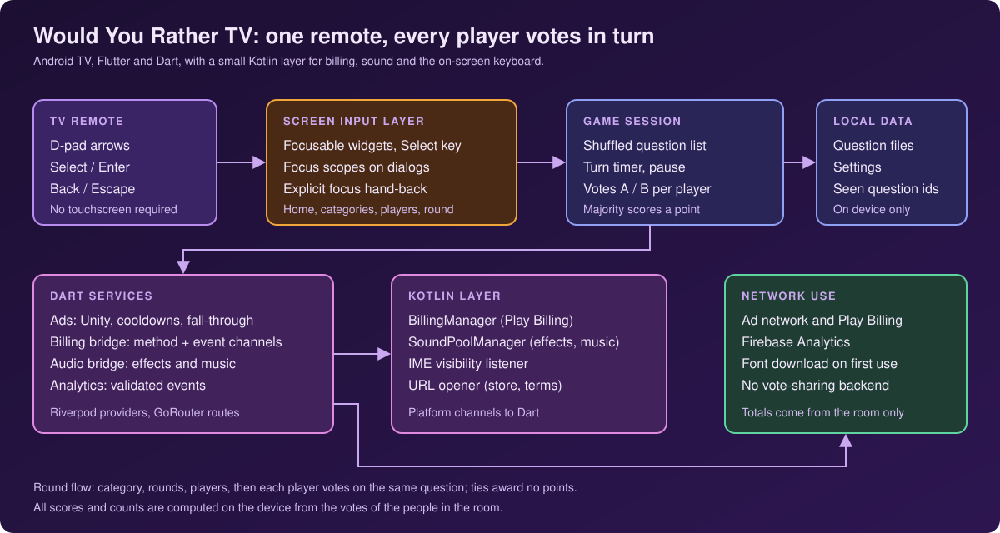
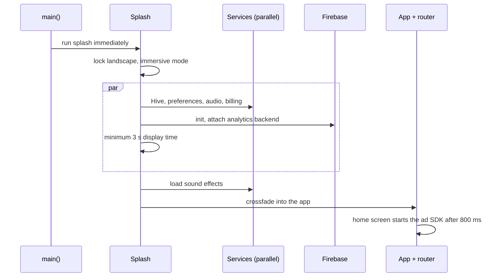
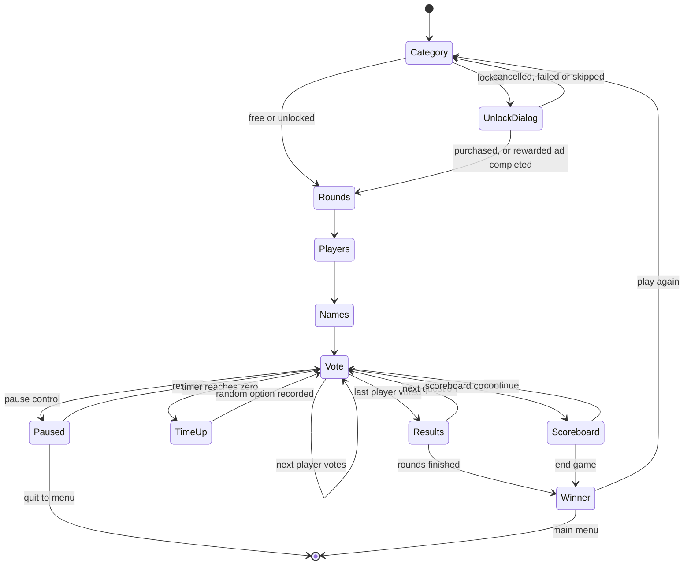
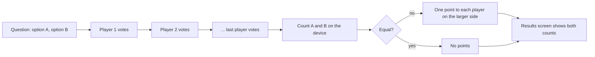
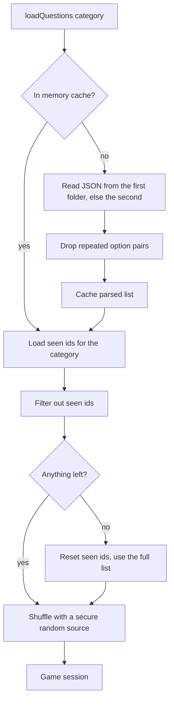
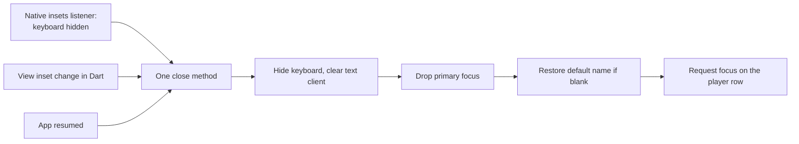

# Architecture

Conceptual view of the Android TV app. Names are descriptive, not production identifiers.

## Layers

| Layer | Responsibility |
|---|---|
| Input | Focusable widgets handle Select and Enter; Flutter's directional traversal moves between them; one root hook plays click sounds |
| Screens | Splash, home, how to play, settings, other apps, category, rounds, player count, player names, vote, results, scoreboard, winner |
| State | Riverpod notifiers for the game session, settings and categories; Freezed models |
| Data | Bundled JSON question files, preferences for settings and purchase flags, a Hive box for scores, counters and seen question ids |
| Services | Ads, billing bridge, audio bridge and analytics in Dart |
| Native | Kotlin billing manager, sound manager, IME listener and URL opener on the activity host |

## Startup

If Firebase fails to initialise, a no-op analytics backend stays attached and the app continues.

## A game

## Voting and scoring

There is no network step between the votes and the results screen. Counts are those of the players in the room.

## Question loading

Seen ids are written when a game is ended through the normal finish or the scoreboard's end action. Quitting from the pause menu discards the session without recording them.

## Keyboard closing on a TV

## Platform channels

| Channel | Direction | Purpose |
|---|---|---|
| Billing methods | Dart to Kotlin | Initialise, query products, purchase, list purchases |
| Billing events | Kotlin to Dart | Connection changes and purchase updates |
| Audio methods | Dart to Kotlin | Initialise, load and play effects, play and stop music, volume and mute |
| IME | Kotlin to Dart | Keyboard hidden |
| Utilities | Dart to Kotlin | Open a URL with a view intent |

## Network use

- Ad network (banner, interstitial, rewarded) and Play Billing.
- Firebase Analytics.
- Runtime font download, by default, through the fonts package.
- No service stores or shares game data, questions or votes.
